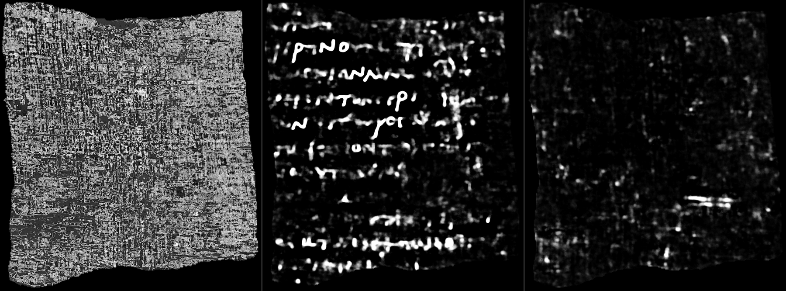
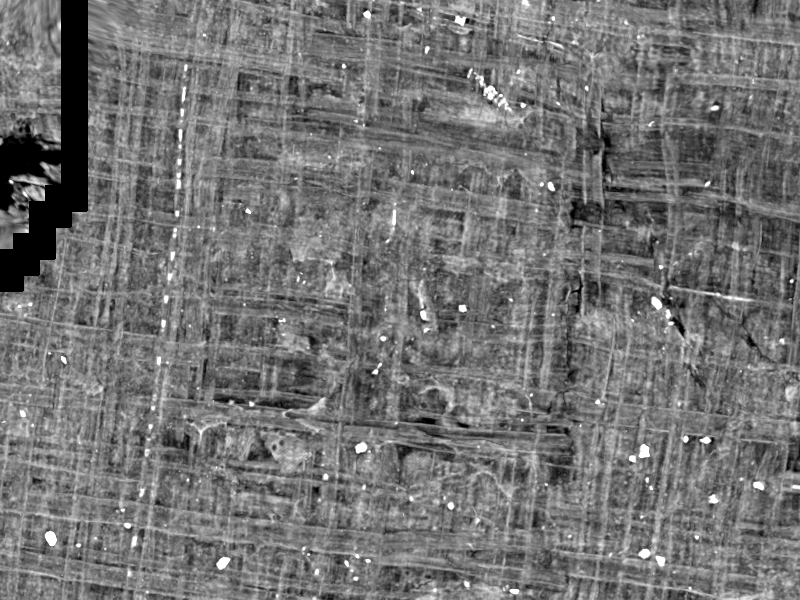

# Looking for the first letters in an unread Herculaneum scroll

A research journal of my work on the [Vesuvius Challenge](https://scrollprize.org) "First Letters" prize: reading carbonized papyrus scrolls from Herculaneum using X-ray CT scans and machine learning. I worked on a laptop with a 4 GB GPU, in November 2026.

**Short version.** I built a full pipeline that runs on that laptop. It goes from the raw CT scan to flattened sheets of papyrus, then to ink predictions, and every step is checked against a scroll that has already been read. I used a self-supervised 3D vision model to pick which unread scroll to attack. Then I unrolled almost 500 cm² of papyrus from it and ran two ink models over the surface. **I have not found letters yet.** What I do have is a method I trust: every "no ink" verdict comes with a positive control showing that the same chain *does* reveal letters where letters exist.

<p align="center">
  <br>
  <em>Positive control on PHerc. 0139, a scroll that has already been read. Left: CT surface. Centre: ink model, correct depth order, where Greek letters appear. Right: the same model with the depth order reversed, which gives noise. Every negative result below is checked against a control like this one.</em>
</p>

---

## The problem in three lines

- In 79 AD, Vesuvius carbonized hundreds of papyrus scrolls in a villa at Herculaneum. They cannot be opened without destroying them.
- Synchrotron CT scans give 3D volumes of the rolled scrolls. To read one, you have to:
  1. find the papyrus sheet inside the volume;
  2. flatten it, which is called "virtual unwrapping";
  3. detect the carbon ink, which is nearly the same density as the carbonized papyrus.
- The First Letters prize pays $50,000 for at least 10 legible letters in a 4 cm² area of a scroll where no one has read anything yet.

## What I did

| Step | Question | What I did | Outcome |
|---|---|---|---|
| 1. [Literature review](docs/01-literature-review.md) | How were the first letters found in the scrolls already read? | Read and compared the published winning write-ups, community models and prize rules, separating organiser facts from author claims | Two things matter: **surface area** and **a model that matches the scan conditions** |
| 2. [First baselines](docs/02-first-baselines.md) | Do public ink models see anything on my first target, PHerc. 0800? | Ran 4 families of ink models (official ink_9um ensemble, Reader v3, Argus v3, Studio) on the 6 public segments (9.2 cm²), in both depth orders, in fp32 | No letters. The strongest responses follow cracks, a seam and damaged areas, not text. The pipeline itself was validated on a control |
| 3. [Choosing a scroll](docs/03-choosing-a-scroll-with-dino.md) | Which of the 19 eligible scrolls looks most like the scrolls the best ink model was trained on? | Embedded 24 random CT cubes from each of 26 scrolls with a self-supervised 3D ViT (DINO), then scored similarity with bootstrap confidence intervals | PHerc. 1545 came in the top two in all 4 variants, while PHerc. 0800 sat in the bottom half. I switched targets |
| 4. [Whole-scroll unwrapping](docs/04-whole-scroll-unwrapping.md) | Can I get much more surface than the 9 cm² published? | Ran HerculeX, an open-source unwrapping pipeline, on a band of PHerc. 1545 overnight on the laptop GPU | 761 flattened pieces, 471 cm², with papyrus fibres clearly visible. Two ink models saw no text |
| 5. [Controls](docs/05-controls.md) | Is "no text" a real result, or a bug in how I fed the data to the model? | Rebuilt HerculeX's exact input format on the control scroll and re-ran the model | The control letters reappear unchanged. The negative result is real |
| 6. [Lessons and next steps](docs/06-lessons-and-next-steps.md) | What next? | Moved to PHerc. 0846A, ranked third by DINO, where another participant has reported a cluster of letters (not yet verified) | Run in progress |

<p align="center">
  <br>
  <em>A flattened surface from PHerc. 1545, rendered from the CT scan, about 7.5 × 5.6 mm. The crossing horizontal and vertical papyrus fibres are visible, which shows the surface sits on the sheet. Bright dots are dense mineral grains.</em>
</p>

## What I learned

- **A model's output is a hypothesis, not a result.** On my first target, four model families agreed with each other strongly (r = 0.6–0.85). But they were agreeing on *physical structure*: a crack, a seam, a damaged patch. Agreement between models is not evidence of ink.
- **Always run a positive control before believing a negative.** Each time I changed the data format, I re-checked the full chain on a scroll where the letters are known. Once, this was the only way to tell "nothing here" apart from "my code is broken".
- **Measure before choosing.** I first picked the target scroll for good reasons: same scanner session as a scroll that had been read. A quantitative comparison with DINO said otherwise, so I changed target. I reported the uncertainty (bootstrap CIs, leave-one-out accuracy of 23–32 % against 4 % chance) instead of a single ranking.
- **Know your hardware.** Half precision (fp16) gave NaNs on my GPU, so every model runs in fp32. I adapted batch sizes and tiling to 4 GB of VRAM. That brought an overnight unwrapping of 471 cm² within reach of a laptop.
- **Report negative results honestly.** Most of the area I examined shows no detectable ink. In a real scroll that is expected: margins, blank areas, inner turns. A clear, controlled negative still narrows the search.

## Repository map

```
docs/            one page per step (English); docs/fr/ has the full literature review (French)
figures/         controls, DINO similarity matrices, flattened surfaces (CT only)
scripts/dino/    sample CT cubes over HTTPS, embed them with DINO, rank scrolls with bootstrap
scripts/readers/ fp32 wrappers for ink models, the HerculeX-format control, figure panels
scripts/herculex/ band run settings for a 4 GB GPU, crop export from the HerculeX tile store
```

The scripts are research code. They expect the [villa](https://github.com/ScrollPrize/villa) environment, a local [HerculeX](https://github.com/adambetka2/HerculeX) install and the model checkpoints listed in each docs page. The data is the public Vesuvius Challenge open data.

## Notes

- **Confidentiality.** Under the prize rules, I am not publishing ink predictions for scrolls that are still eligible. Ink images here come only from PHerc. 0139, a scroll that has already been read and is used as a control. Images of eligible scrolls show the CT scan only.
- **Credits.** Data: Vesuvius Challenge / EduceLab / ESRF. Models: ink_9um (Vesuvius Challenge), Reader v3 (domenicor046), Argus v3 (ruiconte), Studio (Priyank Aranke, weights CC BY-NC 4.0), DINO 3D ViT `dinovol` (Vesuvius Challenge). Unwrapping: HerculeX (adambetka2 and contributors).
- **Tools.** I ran this work with an AI coding assistant (Claude Code) for scripting and debugging. The research questions, target choices and interpretation of results were mine. I can explain and defend every step.
