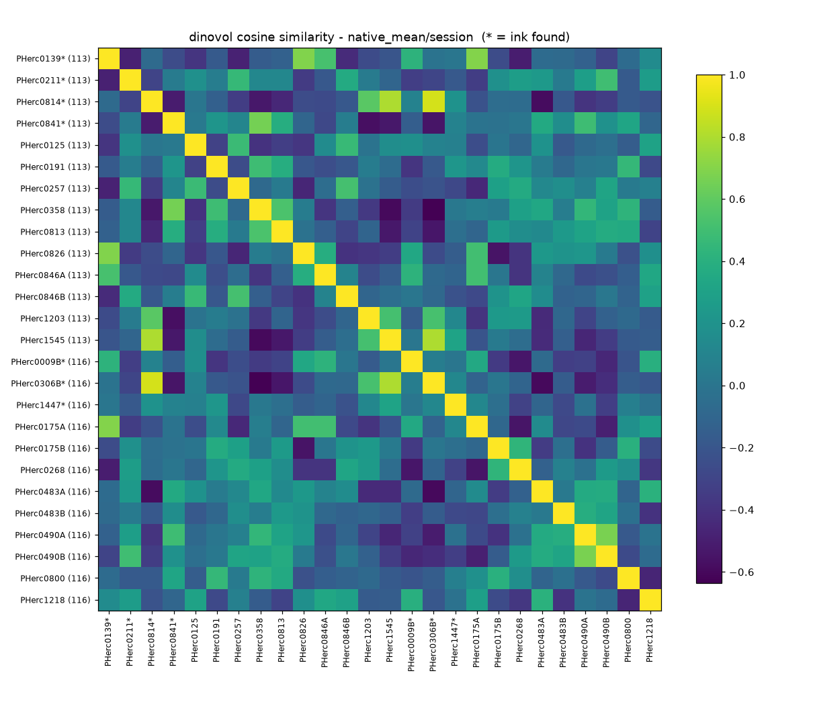
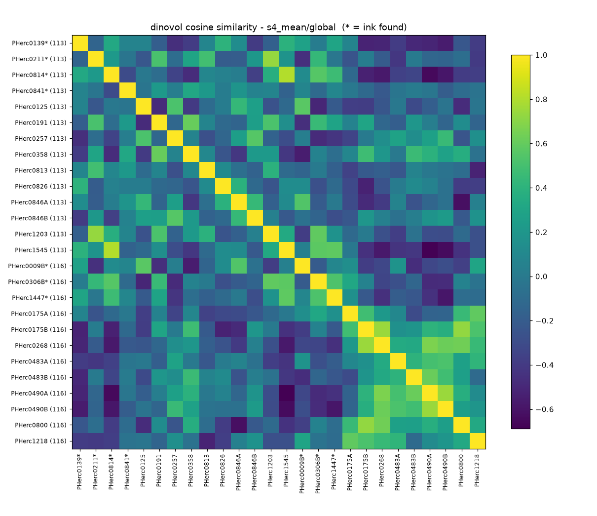

# 3. Choosing a scroll with a self-supervised 3D model

## Question

There are 19 scrolls still eligible for First Letters, and unwrapping one takes hours of GPU time. **Which scroll looks most like the scrolls the best ink model (Studio) was trained on?** The PHerc. 211 winner used this kind of DINO similarity to choose training scrolls. I turned the idea around and used it to choose the target.

## Method

1. **Sampling** ([`dino_sample.py`](../scripts/dino/dino_sample.py)). For each of 26 scrolls (19 eligible and 7 with known ink), I drew 24 random 128³ cubes of the full-resolution scan.
   - They were fetched directly over public HTTPS from the open-data bucket, with no full download.
   - Cubes were taken in the central disc of the scroll, between 15 % and 85 % of its height, and only if at least 70 % of the voxels were non-empty.
   - The seed is fixed per scroll, so the sample is reproducible.
2. **Embedding** ([`dino_embed.py`](../scripts/dino/dino_embed.py)). I used `dinovol`, a 216M-parameter 3D ViT from the Vesuvius Challenge (MIT licence), with patch size 8.
   - Each cube gives the mean patch token and the CLS token, in two variants:
     - **native**: resampled to a common 9.362 µm grid, centre 112³;
     - **s4**: densest 32³ sub-cube, upsampled ×4.
   - The s4 variant exists because the model was **trained on ~2.4 µm scans**, and our scans are ~9 µm. The s4 variant brings the apparent scale closer to what the model knows.
   - Runtime: about 4 s per cube on the GTX 1650.
3. **Scoring** ([`dino_analyse.py`](../scripts/dino/dino_analyse.py)).
   - Score = mean cosine similarity between a scroll's centroid and the centroids of Studio's core training scrolls (PHerc. 0009B, 0841, 0814).
   - Centring is either global or per scan session (113 vs 116 keV), so that the session effect does not dominate.
   - 200 bootstrap resamples of the cubes give confidence intervals and "top-5 frequency".
4. **Sanity check.** Can the embeddings tell scrolls apart at all? With leave-one-out cube→scroll assignment, accuracy is **32 % (native) and 23 % (s4)**, against 4 % by chance. That is a real but modest signal.

## Results

| Variant | Top 3 eligible scrolls (score, top-5 frequency) | PHerc. 0800 |
|---|---|---|
| native, global centring | 0125 (0.116, 97 %), **1545** (0.112, 97 %), 0826 | 12th / 19 |
| native, session centring | **1545** (0.093, 95 %), 0125, 0175A | 6th / 19 |
| s4, global centring | 0846A (0.251, 99 %), **1545** (0.230, 98 %), 0125 | 15th / 19 |
| s4, session centring | 0175A, **1545**, 0846A | 12th / 19 |

**PHerc. 1545 is the only scroll in the top two of all four variants.** It sits in a cluster with PHerc. 0814 and 0306B, two scrolls that have already been read. My first target, PHerc. 0800, is in the bottom half everywhere. So I switched to PHerc. 1545, keeping 0846A and 0125 as the next candidates.

  
   
  <em>Scroll-to-scroll similarity matrices (left: native, session-centred; right: s4, global centring).</em>

## Caveats

- The model is used **off-scale**: trained at 2.4 µm, applied at 9 µm.
- The score measures **texture similarity**, not ink. It is a prior for choosing, not evidence that a scroll is readable.
- One scroll (PHerc. 0343P) was excluded because its chunk format did not match its metadata.
