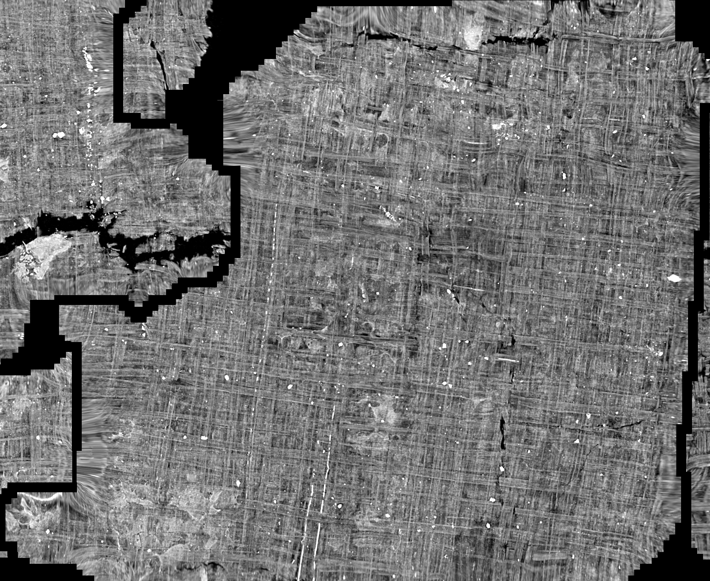

# 4. Whole-scroll unwrapping with HerculeX

## Why

The literature review showed that winners swept large surfaces. [HerculeX](https://github.com/adambetka2/HerculeX) is an open-source pipeline that does this automatically on a raw CT volume:

1. detects sheet points with structure tensors;
2. assigns each patch an integer winding number of the spiral, using an exact min-cost-flow solve;
3. flattens each piece isometrically;
4. renders a layer stack along the surface normals and reads the ink (Reader v3 by default).

## Running it on a 4 GB laptop GPU

Settings ([`hx_band_1545.sh`](../scripts/herculex/hx_band_1545.sh)): fp32 reader, smaller work units, and only the CT bricks that are actually needed are listed and fetched. The run was one band of PHerc. 1545, overnight:

| | |
|---|---|
| CT bricks fetched | 6,203 (11.4 GiB), about 35 MB/s |
| Flattened pieces | 761 |
| Surface | **470.6 cm²** (327 cm² in pieces ≥ 1 cm²), about 50 times the published surface of my first target |
| Largest piece | 2.1 cm² (none ≥ 4 cm²) |
| Total time | about 1 h 10 min, end to end |

**Limits.** Pieces are not joined into a continuous sheet ("0 joints"), and the author says the global fit is still weak. HerculeX is therefore a **prospecting** tool: it shows *where* to look. A prize submission would then need a clean ≥ 4 cm² surface built around the promising spot.

   
  <em>One flattened piece of PHerc. 1545 (CT only, about 18 × 15 mm). The fibre cross-hatching shows the surface follows the sheet. Black areas are outside the piece.</em>

## Reading the ink

- HerculeX stores the read pieces as a tile pyramid for its viewer, not as images. I wrote [`hx_crops_1545.py`](../scripts/herculex/hx_crops_1545.py) to cut each piece back out of the tile store at full resolution.
- I ranked the pieces by HerculeX's ink score:
  - the median piece scores **0**;
  - 90 % score below 0.02;
  - about ten pieces stand out, at 0.06 to 0.12.
- For the top 10, I made scan | central layer | ink panels and inspected them by eye. They show only diffuse 1–3 mm blobs, with no strokes and no rows, and several of them sit on damaged areas.
- I ran Studio, the strongest model, on the two most interesting pieces, in both depth orders, at about 8 min per piece ([`studio_npy.py`](../scripts/readers/studio_npy.py), using the HerculeX layer stack exported by [`hx_stack_export.py`](../scripts/herculex/hx_stack_export.py)).
  - Studio flags 10–37 % of the surface as "ink". That is far too much for text, and it shows tiling artefacts: the signature of a model that is out of its depth.
  - There are no rows and no interline gaps.

Before concluding, I had to rule out one possibility. Maybe Studio was not getting the input it expects: HerculeX keeps only 17 layers, while Studio was trained on renders of 31 layers. That is the subject of the [controls page](05-controls.md).

*Ink maps of PHerc. 1545 are not published here, because the scroll is still eligible for the prize.*
