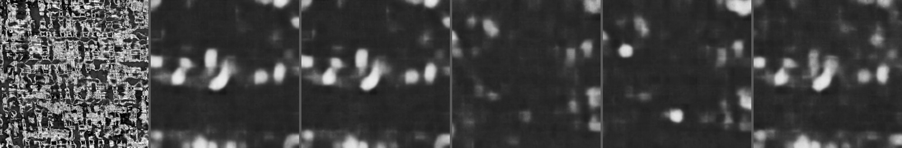

# 5. Controls: is "no text" a real result?

A negative result only means something if the same chain *can* show a positive one. Every step of this project was paired with a control.

## Control scroll

I used segment w035 of **PHerc. 0139**, a scroll where Greek letters are already readable at 9 µm. It is not eligible for the prize, so its ink maps can be shown.

**Caveat:** PHerc. 0139 is part of the training data of some models (Reader, Studio). A control on it therefore checks the **plumbing**: depth order, data format, precision. It does not measure how sensitive a model is on an unseen scroll.

## Control 1: depth order (pipeline check)

On w035, Reader v3 shows clean Greek letters with the correct depth order, and noise when the order is reversed (figure in the README). Real ink is tied to a specific layer of the sheet. Reversing the depth destroys it, while cracks and density artefacts survive. This gives:

- a check that each new pipeline uses the right orientation;
- a test to apply to any candidate.

## Control 2: the HerculeX input format

**Question.** On PHerc. 1545, Studio saw no text in HerculeX layer stacks. Maybe this is not because the papyrus is blank, but because HerculeX keeps only 17 layers, chosen around the sheet face, while Studio expects a specific 16-plane window of a 31-layer render.

**Test** ([`w035_hxwindow.py`](../scripts/readers/w035_hxwindow.py)).

1. I applied HerculeX's own window-selection code to the w035 control volume, for both orientations of the stack.
2. For w035, the HerculeX window covers planes 6–22. The reference window that already worked for Studio is planes 7–22.
3. I ran Studio on these HerculeX-format windows, in all four orientation × order combinations, and compared them to the reference.

   
  <em>From left to right:</em>

1. CT layer;
2. Studio on the reference window;
3. Studio on the HerculeX window, correct order: **identical letter rows**;
4. HerculeX window, reversed order: noise;
5. other face, upward order: noise;
6. other face, downward order: weaker rows.

**Result.** With the HerculeX format, Studio reproduces the reference letter rows almost pixel for pixel. **The format is valid**, so the negative result on PHerc. 1545 is real, at least on the sheet face that HerculeX selected.

## What real ink looks like at this resolution

At 9 µm, even confirmed letters look like **blobs arranged in rows, with regular dark interline gaps**, and they cover around 9 % of the area. That gives a concrete criterion when screening new pieces. Isolated blobs spread over a quarter of the surface do not look like text.
